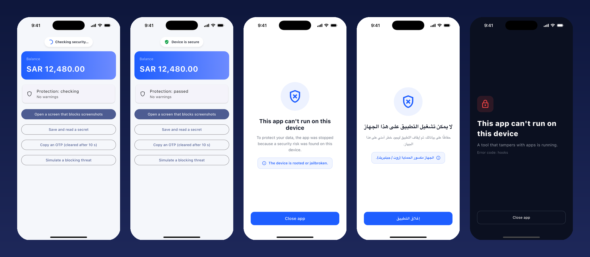
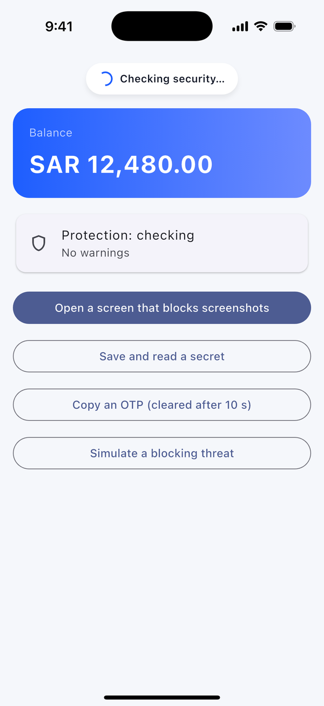
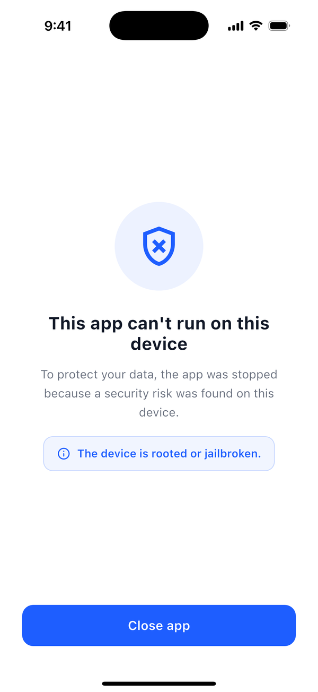
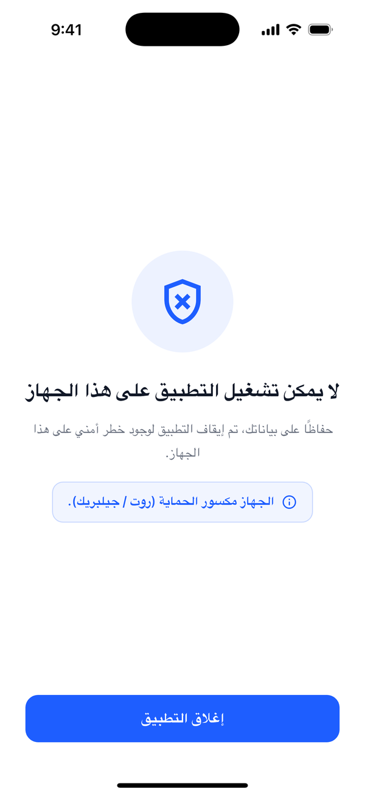
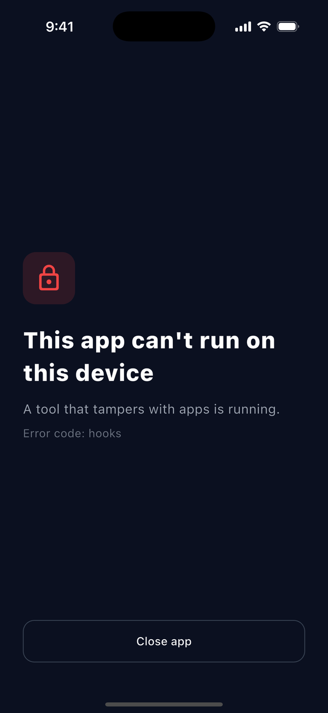

<p align="center">
  
</p>

<h1 align="center">AppArmor</h1>

<p align="center">
  <b>All-in-one mobile security for Flutter.</b><br>
  One call in <code>main()</code>: runtime protection, screen privacy, secure storage, certificate pinning, safe logging and session control.<br>
  Every check can be turned on, turned off, or set to warn instead of block.
</p>

<p align="center">
  <a href="https://pub.dev/packages/app_armor"></a>
  
  <a href="LICENSE"></a>
</p>

<p align="center"><a href="#بالعربية">العربية ⬇</a></p>

---

## Contents

- [Features](#features)
- [Install](#install)
- [Quick start](#quick-start)
- [Getting every configuration value](#getting-every-configuration-value)
- [Configuration reference](#configuration-reference)
- [Threats and policies](#threats-and-policies)
- [Customizing the blocked screen and the loader](#customizing-the-blocked-screen-and-the-loader)
- [Screen privacy](#screen-privacy)
- [Secure storage](#secure-storage)
- [Certificate pinning](#certificate-pinning)
- [WebView and links](#webview-and-links)
- [Logs](#logs)
- [Session timeout](#session-timeout)
- [Clipboard](#clipboard)
- [Native hardening command](#native-hardening-command)
- [Release checklist](#release-checklist)
- [Troubleshooting](#troubleshooting)
- [Limits](#limits)

## Features

| | Feature | What it does |
|---|---|---|
| 🛡️ | **Runtime protection (RASP)** | Detects Frida and other hooking tools, debuggers, root/jailbreak, emulators, modified or re-signed apps, unofficial stores and 16 more threats. |
| ⚖️ | **Threat policy** | Block, warn or ignore each threat. Presets: `recommended`, `strict`, `monitorOnly`. |
| 🚫 | **Blocked screen** | Covers the app with a clear screen in Arabic or English, showing the reason. Restyle it or replace it. |
| ⏳ | **Checking badge** | A small loader while the checks run, then "Device is secure". Restyle it or replace it. |
| 🙈 | **App switcher privacy** | A blur (iOS) or blank card (Android 13+) instead of a snapshot of the app. |
| 📵 | **Screenshot blocking** | For the whole app, or only for chosen screens. |
| 🎥 | **Cover while recording** | iOS: blurs the app while the screen is recorded, mirrored or cast. |
| 👆 | **Tapjacking protection** | Android: ignores taps that pass through another app's overlay. |
| 📸 | **Screenshot detection** | Reports screenshots (iOS, Android 14+) and screen recording (iOS). |
| 🤐 | **Silent release logs** | No `print` / `debugPrint` output in release builds. |
| 🔐 | **`ArmorVault`** | Keychain / Keystore storage that never leaves the device, is cleared on reinstall, and moves old plain-text values in. |
| 📌 | **`ArmorPinning`** | Public key (SPKI) or certificate pinning for Dio. |
| 🌐 | **`ArmorWebViewPolicy`, `SafeUrls`** | Keeps WebViews on your domains; opens only HTTPS links. |
| 🧽 | **`LogRedactor`** | Masks passwords, tokens, JWTs and card numbers in logs. |
| ⏱️ | **`ArmorSessionGuard`** | Ends the session after inactivity or time in the background. |
| 📋 | **`ArmorClipboard`** | Copies OTPs and IBANs, then clears them. |
| 🧰 | **`dart run app_armor`** | Android: no backups, HTTPS only, no user certificates. Checks your release settings. |

## Install

```yaml
dependencies:
  app_armor: ^0.1.0
```

| Platform | Minimum |
|---|---|
| Android | `minSdk 23` |
| iOS | 13.0 |
| Flutter | 3.24 |

Then apply the native settings from your app's root folder:

```sh
dart run app_armor --check   # report what is missing, change nothing
dart run app_armor           # apply it
```

## Quick start

```dart
import 'package:app_armor/app_armor.dart';

void main() => AppArmor.run(
      config: ArmorConfig(
        rasp: const RaspConfig(
          androidPackageName: 'com.company.app',
          androidSigningCertHashes: [
            'AB:CD:…:EF', // upload key
            '12:34:…:56', // Google Play app signing key
          ],
          iosBundleIds: ['com.company.app'],
          iosTeamId: 'ABCDE12345',
        ),
      ),
      app: () async {
        await Firebase.initializeApp(); // any other start-up work
        return const MyApp();
      },
    );
```

`AppArmor.run` initializes Flutter, starts every enabled feature, silences logs in release builds, and wraps your app in `ArmorGate`, which shows the loader and the blocked screen.

### Keeping your own `main`

```dart
Future<void> main() async {
  WidgetsFlutterBinding.ensureInitialized();
  await AppArmor.init(ArmorConfig(rasp: …));
  runApp(const MyApp());
}

// MaterialApp or GetMaterialApp
MaterialApp(
  builder: AppArmor.builder(), // or AppArmor.builder(yourOwnBuilder)
);
```

With `AppArmor.builder`, the screens follow your app's language automatically. With `AppArmor.run`, the gate sits above `MaterialApp`, so call `AppArmor.setLocale(const Locale('ar'))` if your app's language differs from the device's.

## Getting every configuration value

Everything `RaspConfig` needs, and where to find it.

### `androidPackageName`

Your Android application ID.

```sh
grep -E "applicationId" android/app/build.gradle*
# applicationId = "com.company.app"
```

### `androidSigningCertHashes`

The SHA-256 fingerprint of **every key your Android app is signed with**. AppArmor accepts the hex form (`AB:CD:…`) as printed by the tools below, or Base64.

**1. Your upload / release key** (the `.jks` or `.keystore` in your release signing config):

```sh
keytool -list -v -keystore android/app/upload-keystore.jks -alias upload
# Certificate fingerprints:
#   SHA256: 3E:42:C5:0F:…:5C:D8   <- copy this
```

Or let Gradle print every signing config:

```sh
cd android && ./gradlew signingReport
# Variant: release … SHA-256: 3E:42:C5:0F:…
```

**2. The Google Play app signing key.** If you use Play App Signing (default for new apps), Google re-signs the app with its own key, so store installs carry a **different** fingerprint than your upload key:

> Play Console → your app → **Test and release → Setup → App integrity → App signing** → *App signing key certificate* → **SHA-256 certificate fingerprint**

**3. Any other key** used to distribute builds: another store, Firebase App Distribution signed with a different key, or the debug key if you test with `runInDebug: true`:

```sh
keytool -list -v -keystore ~/.android/debug.keystore \
  -alias androiddebugkey -storepass android -keypass android
```

> ⚠️ If the Google Play key is missing, every user who installs from the store is reported as `tampering`. Add it before releasing, or set `tampering` to `warn` until you have it.

To convert hex to Base64 yourself: `echo "3E42C50F…5CD8" | xxd -r -p | base64`.

### `androidSupportedStores`

Google Play is always allowed. Add the installer package of any other store you publish to:

| Store | Package |
|---|---|
| Huawei AppGallery | `com.huawei.appmarket` |
| Samsung Galaxy Store | `com.sec.android.app.samsungapps` |
| Amazon Appstore | `com.amazon.venezia` |
| Xiaomi GetApps | `com.xiaomi.mipicks` |

### `iosBundleIds`

Your app's bundle identifier:

```sh
grep -m1 "PRODUCT_BUNDLE_IDENTIFIER" ios/Runner.xcodeproj/project.pbxproj
# PRODUCT_BUNDLE_IDENTIFIER = com.company.app;
```

Or in Xcode: **Runner target → General → Identity → Bundle Identifier**. List every bundle ID the same code ships under (for example separate staging apps).

### `iosTeamId`

The 10-character Apple Developer Team ID:

```sh
grep -m1 "DEVELOPMENT_TEAM" ios/Runner.xcodeproj/project.pbxproj
# DEVELOPMENT_TEAM = ABCDE12345;
```

Or **[developer.apple.com/account](https://developer.apple.com/account) → Membership details → Team ID**.

### `watcherMail` (optional)

Any email address. Talsec, the company behind the freeRASP engine, sends a weekly security report there: how many devices were rooted, hooked, and so on. Leave it empty for no reports.

### Certificate pins (optional)

See [Certificate pinning](#certificate-pinning) for the `openssl` commands.

## Configuration reference

```dart
ArmorConfig(
  enabled: true,                    // master switch: false = AppArmor does nothing
  policy: ThreatPolicy.recommended(),
  rasp: RaspConfig(…),              // null = no runtime checks
  privacy: PrivacyConfig(…),
  silenceLogsInRelease: true,
  ui: ArmorUiConfig(…),
  onThreat: (event) { … },          // every threat that isn't ignored
)
```

### `RaspConfig`

| Option | Default | Description |
|---|---|---|
| `androidPackageName` | required | See above. |
| `androidSigningCertHashes` | required | See above. Hex or Base64. |
| `androidSupportedStores` | `[]` | Extra stores besides Google Play. |
| `iosBundleIds` | required | See above. |
| `iosTeamId` | required | See above. |
| `watcherMail` | `''` | Weekly report address. |
| `killOnBypass` | `true` | Closes the app if an attacker hooks the threat callbacks themselves. |
| `runInDebug` | `false` | Debug builds skip the checks so `flutter run`, the debugger and emulators keep working. |
| `checkTimeout` | `20s` | The loader hides if the engine never reports back. |

### `PrivacyConfig`

| Option | Default | Description |
|---|---|---|
| `hideInAppSwitcher` | `true` | Blur (iOS) / blank card (Android 13+) in the app switcher. |
| `blockScreenshots` | `false` | Blocks screenshots and recording in the whole app (Android). On iOS it covers the app while recording. |
| `coverWhileRecording` | `false` | iOS: blur while the screen is recorded, mirrored or cast. |
| `preventTapjacking` | `true` | Android: ignore taps through other apps' overlays. |
| `detectScreenshots` | `true` | Report `screenshot` / `screenRecording` through the policy. |

`PrivacyConfig.off` turns all of them off.

### `ArmorUiConfig`

| Option | Default | Description |
|---|---|---|
| `showStatusBadge` | `true` | Show the checking loader. |
| `badgePosition` | `top` | `top` or `bottom`. |
| `showBlockReason` | `true` | Show why the app was blocked. |
| `showCloseButton` | `true` | Show the "Close app" button. |
| `texts` | by locale | `ArmorTexts.english`, `ArmorTexts.arabic`, or your own. |
| `primaryColor`, `successColor`, `backgroundColor`, `titleColor`, `messageColor`, `badgeColor` | | Colors. |
| `blockedIcon` | `Icons.gpp_bad_outlined` | Icon of the blocked screen. |
| `fontFamily` | app font | Font for both screens. |
| `blockedScreenBuilder` | | Your own blocked screen. |
| `statusBadgeBuilder` | | Your own loader. |

## Threats and policies

| `ArmorThreat` | Meaning | Platforms | `recommended` |
|---|---|---|---|
| `hooks` | Frida, Xposed or another hooking tool | Android, iOS | **block** |
| `debugger` | A debugger is attached | Android, iOS | **block** |
| `rootOrJailbreak` | Rooted / jailbroken device | Android, iOS | **block** |
| `tampering` | App modified, re-signed, or wrong bundle ID | Android, iOS | **block** |
| `emulator` | Emulator or simulator | Android, iOS | **block** |
| `unofficialStore` | Not installed from an allowed store | Android, iOS | warn |
| `automation` | An automation tool drives the UI | Android | warn |
| `noScreenLock` | No PIN, pattern, password or biometrics | Android, iOS | warn |
| `noSecureHardware` | No hardware keystore / Secure Enclave | Android, iOS | warn |
| `developerMode` | Developer options on | Android | warn |
| `adbEnabled` | USB debugging on | Android | warn |
| `deviceIdChanged` | App was reinstalled | iOS | warn |
| `deviceBinding` | App moved to another device | Android, iOS | warn |
| `obfuscationIssues` | Release build isn't obfuscated | Android, iOS | warn |
| `vpn` | System VPN active | Android, iOS | warn |
| `multiInstance` | Running as a cloned copy | Android | warn |
| `unsecureWifi` | Open or weak Wi-Fi | Android | warn |
| `timeSpoofing` | Device time changed | Android, iOS | warn |
| `locationSpoofing` | Mock location app | Android | warn |
| `unlockedBootloader` | Bootloader unlocked | Android | warn |
| `screenshot` | User took a screenshot | Android 14+, iOS | ignore |
| `screenRecording` | Screen recorded or mirrored | iOS | warn |

`strict` also blocks `unofficialStore`, `unlockedBootloader`, `multiInstance`, `timeSpoofing`, `automation` and `locationSpoofing`. `monitorOnly` never blocks, so you can measure how many users would be affected before you turn blocking on.

```dart
policy: ThreatPolicy.recommended()
    .copyWith({
      // QA uses emulators with test builds
      ArmorThreat.emulator: isProduction ? ThreatAction.block : ThreatAction.warn,
      ArmorThreat.vpn: ThreatAction.warn,
    })
    .ignoring([ArmorThreat.developerMode]),
```

| Action | Result |
|---|---|
| `block` | The blocked screen covers the app. |
| `warn` | The app keeps running. The threat is added to `AppArmor.status.value.warnings` and sent to `onThreat`. |
| `ignore` | Nothing happens. |

**React to warnings**, for example to disable payments on a rooted device without blocking the whole app:

```dart
ValueListenableBuilder<ArmorStatus>(
  valueListenable: AppArmor.status,
  builder: (context, status, _) => PayButton(
    enabled: !status.hasWarning(ArmorThreat.rootOrJailbreak),
  ),
);
```

**Send threats to analytics:**

```dart
onThreat: (event) => analytics.log('security_threat', {
  'type': event.threat.name,
  'action': event.action.name,
}),
```

**Report your own checks** through the same policy:

```dart
if (!await api.verifyAppAttestation()) {
  AppArmor.reportThreat(ArmorThreat.tampering);
}
```

## Customizing the blocked screen and the loader

| Checking | Passed | Blocked | Arabic | Custom design |
|:-:|:-:|:-:|:-:|:-:|
|  |  |  |  |  |

### 1. Restyle the built-in screens

```dart
ui: const ArmorUiConfig(
  primaryColor: Color(0xFF0F766E),
  backgroundColor: Color(0xFFF8FAFC),
  blockedIcon: Icons.lock_outline,
  fontFamily: 'Cairo',
  badgePosition: ArmorBadgePosition.bottom,
  showBlockReason: false,
),
```

### 2. Your own texts or language

```dart
ui: ArmorUiConfig(
  texts: ArmorTexts(
    checking: 'Vérification…',
    passed: 'Appareil sécurisé',
    blockedTitle: 'Application bloquée',
    blockedMessage: 'Un risque de sécurité a été détecté.',
    closeApp: 'Fermer',
    textDirection: TextDirection.ltr,
    reasons: {ArmorThreat.rootOrJailbreak: 'Appareil rooté.'},
  ),
),
```

### 3. Your own blocked screen

`blockedScreenBuilder` gives you everything the screen needs: the `threat`, the translated `texts` and `reason`, and a `closeApp` function that works on both platforms. AppArmor keeps every tap away from the app behind it, even if your design leaves gaps.

```dart
ui: ArmorUiConfig(
  backgroundColor: const Color(0xFF0B1020), // also sets the status bar style
  blockedScreenBuilder: (context, d) => Scaffold(
    backgroundColor: const Color(0xFF0B1020),
    body: Padding(
      padding: const EdgeInsets.all(28),
      child: Column(
        crossAxisAlignment: CrossAxisAlignment.start,
        children: [
          const Spacer(),
          const Icon(Icons.lock_outline_rounded, color: Colors.red, size: 40),
          const SizedBox(height: 24),
          Text(d.texts.blockedTitle,
              style: const TextStyle(color: Colors.white, fontSize: 28)),
          Text(d.reason ?? d.texts.blockedMessage,
              style: const TextStyle(color: Colors.white70)),
          Text('Error code: ${d.threat.name}'),
          const Spacer(),
          OutlinedButton(onPressed: d.closeApp, child: Text(d.texts.closeApp)),
        ],
      ),
    ),
  ),
),
```

To keep the default screen and only add something to it (a support phone number, for example), wrap `ArmorBlockedScreen`:

```dart
blockedScreenBuilder: (context, d) => Column(children: [
  Expanded(child: ArmorBlockedScreen(details: d)),
  TextButton(onPressed: callSupport, child: const Text('Call support')),
]),
```

### 4. Your own loader

```dart
ui: ArmorUiConfig(
  statusBadgeBuilder: (context, d) => Chip(
    avatar: d.passed
        ? const Icon(Icons.check, color: Colors.green)
        : const SizedBox.square(
            dimension: 16, child: CircularProgressIndicator(strokeWidth: 2)),
    label: Text(d.label), // "Checking security…" / "Device is secure"
  ),
),
```

`ArmorStatusBadge` is the built-in loader, if you want to wrap it instead. Set `showStatusBadge: false` to show no loader at all.

## Screen privacy

```dart
privacy: const PrivacyConfig(
  hideInAppSwitcher: true,
  blockScreenshots: false,     // true = the whole app
  coverWhileRecording: true,
  preventTapjacking: true,
),
```

Block screenshots only on sensitive screens:

```dart
ArmorSecureScreen(child: CardDetailsPage())
ArmorSecureScreen(enabled: settings.hideBalance, child: WalletPage())
```

Listen to screenshots yourself:

```dart
ArmorNative.onScreenshot.listen((_) => showToast('Screenshots may expose your data'));
```

## Secure storage

```dart
final vault = ArmorVault(
  clearOnReinstall: true, // the iOS Keychain survives uninstalling; start clean
  // Moves values out of an old plain-text store the first time they are read.
  legacyRead: (key) => GetStorage().read<String>(key),
  legacyRemove: (key) => GetStorage().remove(key),
);

await vault.write('refresh_token', token);
final token = await vault.read('refresh_token');
await vault.delete('refresh_token');
await vault.clear(); // on logout
```

Values are stored with `unlocked_this_device` on iOS: they are never synced to iCloud Keychain or restored on another device. Errors never throw: a failed read returns `null`.

## Certificate pinning

Pinning makes the app talk to your API only when the server presents a key you expect, so a proxy with a user-installed or mis-issued certificate can't read the traffic.

```dart
final pinning = ArmorPinning(
  pins: {
    'api.company.com': [
      'sha256/0d6xB7l2pvJw3J5…=',   // current server key
      'sha256/YLh1dUR9y6Kja30…=',   // backup: next key or the CA's intermediate
    ],
  },
  includeSubdomains: false,
  enabled: AppConfig.isProduction,
  onPinFailure: (host, seenPin) =>
      FirebaseCrashlytics.instance.log('Pin failed for $host: $seenPin'),
);

dio.httpClientAdapter = IOHttpClientAdapter(
  validateCertificate: pinning.validateCertificate,
);
```

**Get the pin of your server's key** (`sha256/…`, recommended, survives certificate renewals that keep the same key):

```sh
openssl s_client -connect api.company.com:443 -servername api.company.com </dev/null 2>/dev/null \
 | openssl x509 -pubkey -noout \
 | openssl pkey -pubin -outform der \
 | openssl dgst -sha256 -binary | base64
```

**Get a backup pin from the intermediate CA** (the second certificate in the chain):

```sh
openssl s_client -connect api.company.com:443 -servername api.company.com -showcerts </dev/null 2>/dev/null \
 | awk '/BEGIN CERT/{n++} n==2' | sed -n '/BEGIN/,/END/p' \
 | openssl x509 -pubkey -noout | openssl pkey -pubin -outform der \
 | openssl dgst -sha256 -binary | base64
```

**Whole-certificate pin** (`cert/…`, changes on every renewal):

```sh
openssl s_client -connect api.company.com:443 -servername api.company.com </dev/null 2>/dev/null \
 | openssl x509 -outform der | openssl dgst -sha256 -binary | base64
```

> Always ship at least two pins. If your only pinned key changes, every installed app stops reaching your API until users update.

**Test servers with self-signed certificates** (ignored in release builds unless `allowInRelease: true`):

```dart
ArmorDevCertificates.allow(['qc-api.company.com']);
ArmorDevCertificates.clear();
```

## WebView and links

```dart
final policy = ArmorWebViewPolicy.forSite('https://help.company.com/chat');
// allows company.com and its subdomains, over HTTPS only

NavigationDelegate(onNavigationRequest: (request) {
  switch (policy.decide(request.url, isMainFrame: request.isMainFrame)) {
    case ArmorNavigation.allow:
      return NavigationDecision.navigate;
    case ArmorNavigation.openExternally:
      launchUrl(Uri.parse(request.url), mode: LaunchMode.externalApplication);
    case ArmorNavigation.block:
      break;
  }
  return NavigationDecision.prevent;
});
```

```dart
SafeUrls.https('http://company.com');   // https://company.com
SafeUrls.https('company.com/offers');   // https://company.com/offers
SafeUrls.https('javascript:alert(1)');  // null
SafeUrls.isHttps(remoteConfigUrl);      // validate URLs from remote config
```

## Logs

In release builds `debugPrint` writes nothing, and inside `AppArmor.run` neither does `print`. For logs you keep (crash reports, network inspectors):

```dart
const redactor = LogRedactor();
redactor.redact({'password': 'x', 'user': {'token': 'y'}});
// {password: ***, user: {token: ***}}
redactor.redactText('Authorization: Bearer eyJhbGciOi…');
// Authorization: Bearer ***
redactor.redactText('card 4111 1111 1111 1111');
// card ***1111
```

## Session timeout

```dart
MaterialApp(
  builder: AppArmor.builder((context, child) => ArmorSessionGuard(
        enabled: auth.isLoggedIn,
        inactivityTimeout: const Duration(minutes: 15),
        backgroundTimeout: const Duration(minutes: 5),
        onActivity: auth.refreshTokenIfNeeded,
        onTimeout: (reason) => auth.logout(),
        child: child!,
      )),
);
```

## Clipboard

```dart
await ArmorClipboard.copySensitive(otp, clearAfter: const Duration(seconds: 60));
```

The clipboard is cleared only if it still holds that value.

## Native hardening command

```sh
dart run app_armor [--check] [--no-backup] [--no-network] [--debug-user-certs] [--force]
```

| What it changes | Why |
|---|---|
| `android:allowBackup="false"` + backup and data extraction rules | Tokens and settings never go to cloud backups or device-to-device transfers. |
| `networkSecurityConfig`: HTTPS only, system certificates only | Blocks plain HTTP and certificates users install to intercept traffic. `--debug-user-certs` still allows them in debug builds for Charles / Proxyman. |
| Warns about `usesCleartextTraffic="true"` | Allows plain HTTP. |
| Warns about `NSAllowsArbitraryLoads` (iOS) | Turns off App Transport Security. |
| Warns if R8 is off | Release Java/Kotlin code isn't shrunk or obfuscated. |

It never overwrites values you already set, unless you pass `--force`. Running it twice is safe.

## Release checklist

- [ ] Both Android signing hashes (upload + Google Play) are in `androidSigningCertHashes`.
- [ ] `dart run app_armor --check` reports no missing items.
- [ ] Build obfuscated, and keep the symbols for crash reports:
  ```sh
  flutter build appbundle --obfuscate --split-debug-info=build/symbols
  flutter build ipa --obfuscate --split-debug-info=build/symbols
  ```
- [ ] A release build was tested on a real device, rooted if possible, before going to the store.
- [ ] Certificate pins include a backup pin.

## Troubleshooting

| Problem | Cause and fix |
|---|---|
| Nothing happens in debug | Runtime checks skip debug builds. Use `flutter run --release`, or `runInDebug: true` with a relaxed policy. |
| Store users see "This copy of the app was modified" | The Google Play signing key is missing from `androidSigningCertHashes`. |
| Testers on emulators are blocked | `copyWith({ArmorThreat.emulator: ThreatAction.warn})` for non-production builds. |
| The app closes right after starting | `killOnBypass` closed it because the threat callbacks were hooked. This is expected on attack tools. |
| The blocked screen is in the wrong language | With `AppArmor.run`, call `AppArmor.setLocale(...)`, or use `AppArmor.builder` inside `MaterialApp`. |
| Build warning about Kotlin Gradle Plugin from `freerasp` | It comes from the freeRASP engine and is harmless for now. |

## Limits

- Runtime checks make attacks harder and more expensive. They don't make an app unbreakable, so keep secrets and business rules on your server.
- iOS doesn't let apps block screenshots. AppArmor detects them and covers the app while the screen is recorded.
- The blank app switcher card needs Android 13+. On older versions, use `blockScreenshots` for the same effect.
- Pinning covers Dart HTTP (Dio). Native SDKs such as Firebase use their own network stack.

Runtime protection is powered by [freeRASP](https://pub.dev/packages/freerasp) by Talsec.

---

<div dir="rtl">

## بالعربية

**AppArmor** باكدج متكاملة لحماية تطبيقات Flutter. تضيفها وتناديها مرة واحدة في `main()` فتشتغل كل الحمايات، وكل ميزة أو فحص يمكن تفعيله أو إيقافه أو جعله تحذيرًا بدل الحظر.

### المميزات

- **حماية وقت التشغيل**: كشف Frida وأدوات الـ hooking، مصحح الأخطاء، الروت والجيلبريك، المحاكي، النسخ المعدّلة أو المعاد توقيعها، المتاجر غير الرسمية، و16 فحصًا آخر.
- **سياسة لكل تهديد**: حظر أو تحذير أو تجاهل، مع قوالب جاهزة `recommended` و `strict` و `monitorOnly`.
- **شاشة الحظر ومؤشر التحقق**: بالعربية أو الإنجليزية، ويمكن تعديل ألوانها وخطها وأيقونتها، أو استبدالها بالكامل بتصميمك عن طريق `blockedScreenBuilder` و `statusBadgeBuilder`.
- **خصوصية الشاشة**: إخفاء محتوى التطبيق في قائمة التطبيقات المفتوحة، منع لقطات الشاشة للتطبيق كله أو لشاشات معينة، تغطية التطبيق أثناء تسجيل الشاشة، والحماية من الـ tapjacking.
- **تخزين آمن** في Keychain / Keystore، لا يخرج من الجهاز، ويُمسح عند إعادة التثبيت.
- **تثبيت الشهادة (Pinning)** مع Dio.
- **إخفاء السجلات** في نسخة الإصدار، وإخفاء التوكنات وكلمات المرور وأرقام البطاقات من أي سجل.
- **إنهاء الجلسة** بعد عدم النشاط أو البقاء في الخلفية.
- **أمر إعداد** يمنع النسخ الاحتياطي ويفرض HTTPS ويرفض شهادات المستخدم.

### الاستخدام

</div>

```dart
void main() => AppArmor.run(
      config: ArmorConfig(
        rasp: const RaspConfig(
          androidPackageName: 'com.company.app',
          androidSigningCertHashes: ['<مفتاح الرفع>', '<مفتاح Google Play>'],
          iosBundleIds: ['com.company.app'],
          iosTeamId: 'ABCDE12345',
        ),
        policy: ThreatPolicy.recommended()
            .copyWith({ArmorThreat.emulator: ThreatAction.warn}),
      ),
      app: () {
        AppArmor.setLocale(const Locale('ar'));
        return const MyApp();
      },
    );
```

<div dir="rtl">

ثم من مجلد التطبيق:

</div>

```sh
dart run app_armor
```

<div dir="rtl">

### من أين تحصل على كل قيمة

| القيمة | من أين |
|---|---|
| `androidPackageName` | قيمة `applicationId` في `android/app/build.gradle` |
| `androidSigningCertHashes` | بصمة SHA-256 لمفتاح الرفع: `keytool -list -v -keystore upload-keystore.jks -alias upload` أو `./gradlew signingReport`. **وأيضًا** بصمة مفتاح Google Play من: Play Console ← Test and release ← Setup ← App integrity ← App signing |
| `androidSupportedStores` | متاجر إضافية غير Google Play، مثل `com.huawei.appmarket` |
| `iosBundleIds` | Xcode ← Runner ← General ← Bundle Identifier، أو `PRODUCT_BUNDLE_IDENTIFIER` في `project.pbxproj` |
| `iosTeamId` | developer.apple.com/account ← Membership details ← Team ID، أو `DEVELOPMENT_TEAM` في `project.pbxproj` |
| `watcherMail` | أي بريد لاستلام تقرير أسبوعي من Talsec (اختياري) |
| بصمات الـ Pinning | أوامر `openssl` في قسم [Certificate pinning](#certificate-pinning) |

> **مهم**: نسخ المتجر يوقّعها Google Play بمفتاحه وليس بمفتاح الرفع. أضف البصمتين، وإلا ستُعتبر نسخة المتجر معدّلة. وإلى أن تحصل على مفتاح Play اجعل `tampering` تحذيرًا فقط.

### تخصيص التصميم

</div>

```dart
ui: ArmorUiConfig(
  primaryColor: const Color(0xFF0F766E),
  fontFamily: 'Cairo',
  blockedScreenBuilder: (context, d) => MyBlockedPage(
    title: d.texts.blockedTitle,
    reason: d.reason,
    onClose: d.closeApp,
  ),
  statusBadgeBuilder: (context, d) => MyLoader(text: d.label, done: d.passed),
),
```

<div dir="rtl">

باقي التفاصيل والأمثلة في القسم الإنجليزي بالأعلى.

</div>

## License

MIT © [Mohamed Kinan](https://github.com/mokinan)
